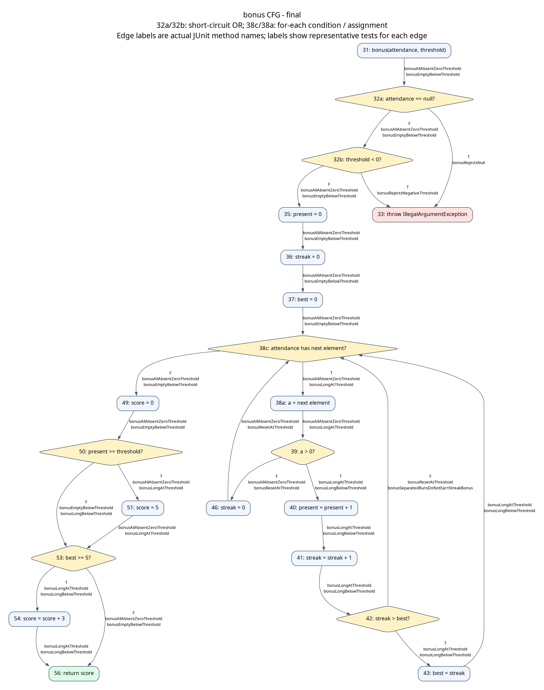

# Лаборатори №10 — Өгөгдлийн урсгалын тест

- Нэр: Б.Дөлгөөн
- Оюутны код: B242270136
- Хичээл: F.CSA313 — Программ хангамжийн чанарын баталгаа ба тест (2026)

## Ажлын орчин

Командуудын бүтэн гаралт: [results/environment.txt](results/environment.txt).

```text
$ java -version
openjdk version "25.0.5.0.3" 2026-10-24
OpenJDK Runtime Environment (build 25.0.5.0.3)
OpenJDK 64-Bit Server VM (build 25.0.5.0.3, mixed mode, sharing)

$ mvn -version
Apache Maven 3.10.0 (c43a36b8d67be7e0805a411bc0898af1a51f5472)
Maven home: /usr/share/java/maven
Java version: 25.0.5.0.3, vendor: Arch Linux, runtime: /usr/lib/jvm/java-25-openjdk
Default locale: en, platform encoding: UTF-8, time zone: Asia/Ulaanbaatar
OS name: "linux", version: "7.2.14-arch1-1", arch: "amd64", family: "unix"
```

## A — gcd-ийн өгөгдлийн урсгалын анализ

Бүх мөрийн дугаар нь
[DataFlowTargets.java](src/main/java/mn/edu/must/sqat/DataFlowTargets.java)
файлын дугаар. `T` нь `y != 0` үнэн, `F` нь худал салаа.
Def-clear замд тухайн хувьсагч def ба use-ийн хооронд дахин оноогдохгүй.
Доорх хүснэгтийн сумнууд гүйцэтгэгдэх зангилааг заана; зөвхөн хаалттай
мөрүүдийг тусдаа зангилаа болгон оруулаагүй.

### A1 — Def/use цэгүүд

| Мөр | Код | Def | c-use | p-use |
| --- | --- | --- | --- | --- |
| 13 | `gcd(int x, int y)` | `x`, `y` | — | — |
| 14 | `int tmp;` | — | — | — |
| 15 | `while (y != 0)` | — | — | `y` (T/F) |
| 16 | `tmp = x % y;` | `tmp` | `x`, `y` | — |
| 17 | `x = y;` | `x` | `y` | — |
| 18 | `y = tmp;` | `y` | `tmp` | — |
| 20 | `return x;` | — | `x` | — |

14-р мөр нь утга оноогоогүй зарлал тул def гэж тооцохгүй. 17-р мөрийн
оноолт `x`-ийн 13-р мөрийн эсвэл өмнөх давталтын 17-р мөрийн def-ийг kill
хийнэ. 18-р мөр нь `y`-ийн 13-р мөрийн эсвэл өмнөх давталтын 18-р мөрийн
def-ийг kill хийнэ. Дараагийн давталтын 16-р мөр өмнөх `tmp`-ийн def-ийг
kill хийнэ; өмнөх утга нь түүнээс өмнө 18-р мөрд хэрэглэгдсэн байна.

### A2 — Бүх DU хос

Use-ийн мөрөөр тоолоход **11 DU хос** байна. Predicate-ийн T/F ирмэгийг
тусад нь үзүүлснээр хүснэгт **13 мөртэй**: `y:13→15` болон `y:18→15`
хос бүрийн хоёр салааг тус тус шалгасан. Хүснэгт нь бүх def-ээс хүрч болох
use цэгийг хамарсан; биелэшгүй хос болон биелэшгүй T/F салаа байхгүй.

| Хувьсагч | Def мөр | Use мөр | c-use/p-use | Def-clear зам | Тестийн ID | Хамрагдсан эсэх |
| --- | --- | --- | --- | --- | --- | --- |
| x | 13 | 16 | c-use | 13 → 15(T) → 16 | G2 | Тийм |
| x | 13 | 20 | c-use | 13 → 15(F) → 20 | G1 | Тийм |
| x | 17 | 16 | c-use | 17 → 18 → 15(T) → 16 | G2 | Тийм |
| x | 17 | 20 | c-use | 17 → 18 → 15(F) → 20 | G2 | Тийм |
| y | 13 | 15 | p-use (T) | 13 → 15(T) → 16 | G2 | Тийм |
| y | 13 | 15 | p-use (F) | 13 → 15(F) → 20 | G1 | Тийм |
| y | 13 | 16 | c-use | 13 → 15(T) → 16 | G2 | Тийм |
| y | 13 | 17 | c-use | 13 → 15(T) → 16 → 17 | G2 | Тийм |
| y | 18 | 15 | p-use (T) | 18 → 15(T) → 16 | G2 | Тийм |
| y | 18 | 15 | p-use (F) | 18 → 15(F) → 20 | G2 | Тийм |
| y | 18 | 16 | c-use | 18 → 15(T) → 16 | G2 | Тийм |
| y | 18 | 17 | c-use | 18 → 15(T) → 16 → 17 | G2 | Тийм |
| tmp | 16 | 18 | c-use | 16 → 17 → 18 | G2 | Тийм |

`x:13→20` хосын замд давталт орвол 17-р мөр эхний `x`-ийг kill хийнэ.
Иймээс энэ хосыг зөвхөн давталтгүй зам хамруулна. `y:13→15(F)` мөн
эхний нөхцөл шалгалт худал байхыг шаарддаг: давталтад орвол 18-р мөр анхны
`y`-ийг kill хийнэ. `x:17→16`, `y:18→16`, `y:18→17` болон
`y:18→15(T)` нь дараагийн давталтад хүрэх шаардлагатай.

### A3 — JUnit тестүүд 

Тестүүд:
[GcdTest.java](src/test/java/mn/edu/must/sqat/GcdTest.java).
Методын нэр болон `@DisplayName`-ууд латин үсэгтэй; `@DisplayName`-д
хамруулж буй хувьсагч, def/use мөрүүдийг тэмдэглэсэн.

| ID | Бодит методын нэр | Оролт | Хүлээгдэх утга | Гүйцэтгэлийн зам |
| --- | --- | --- | --- | --- |
| G1 | `gcdZeroSecondArgumentCoversEntryToReturn` | `gcd(7, 0)` | 7 | 13 → 15(F) → 20 |
| G2 | `gcdTwoIterationsCoversLoopCarriedPairs` | `gcd(12, 8)` | 4 | 13 → 15(T) → 16 → 17 → 18 → 15(T) → 16 → 17 → 18 → 15(F) → 20 |

G1 нь энэхүү багцад `x:13→20` болон `y:13→15(F)`-ийг ганцаараа
хамруулдаг. G2 дараах **хоёр давталт** хийдэг:

| Агшин | x | y | tmp |
| --- | --- | --- | --- |
| Функцэд орох | 12 | 8 | Утга оноогоогүй |
| Эхний давталтын 18-р мөрийн дараа | 8 | 4 | 4 |
| Хоёр дахь давталтын 18-р мөрийн дараа | 4 | 0 | 0 |

Эхний давталт параметрүүдийн def-ээс ирэх use-үүдийг хамруулна. Хоёр дахь
давталт нь `x:17→16`, `y:18→16`, `y:18→17`, `y:18→15(T)`-ийг
хамруулж, төгсгөлд `y:18→15(F)` болон `x:17→20`-д хүрнэ.
`tmp:16→18` давталт бүрд хамрагдана.

Энэ хоёр тест all-DU-pairs хангахад хамгийн цөөн багц болно.
`x:13→20`-ийг хамруулах гүйцэтгэл огт давталт хийхгүй тул 16–18-р
мөрүүдийн def/use-ийг тухайн гүйцэтгэлд хамруулах боломжгүй. Иймээс дор
хаяж давталтгүй нэг, давталттай нэг гүйцэтгэл шаардлагатай; G1 ба G2
эдгээр шаардлага болон бүх DU хосыг хангаж байна.

### A4 — Бодит шалгалтын үр дүн

Ажиллуулсан команд:

```bash
set -o pipefail
mvn verify 2>&1 | tee results/mvn-verify-A.txt
```

[Maven-ийн бүтэн гаралт](results/mvn-verify-A.txt):

```text
Tests run: 2, Failures: 0, Errors: 0, Skipped: 0
BUILD SUCCESS
```

JaCoCo-ийн хадгалсан
[CSV](results/jacoco-A.csv) нь класс түвшний тоог,
[XML](results/jacoco-A.xml) нь `gcd` методын тоог тус тус батална.

| Хамрах хүрээ | Branch covered / total | BRANCH_MISSED | Line covered / total | LINE_MISSED |
| --- | --- | --- | --- | --- |
| `gcd` метод (XML) | 2 / 2 | 0 | 5 / 5 | 0 |
| `DataFlowTargets` класс (CSV) | 2 / 16 | 14 | 5 / 24 | 19 |

Хэсэг A-ийн шалгалтын үед `bonus`-ийн тест хийгдээгүй байсан. Тухайн тайлангийн хамрагдаагүй мөрүүдэд
`bonus`-ийн 18 мөр болон 7-р мөрийн далд constructor багтана.

G2 дангаараа `while`-ийн T болон F салааг туулдаг тул `gcd`-ийн branch
хамралтыг бүрэн өгнө. Гэвч `x:13→20` ба `y:13→15(F)` хамрагдахгүй:
G2-ийн F салаанд хүрсэн `y` нь 13-р мөрийн биш, 18-р мөрийн def-ээс
үүссэн. G1 нэмснээр эдгээр хос хамрагдана. Иймээс branch хамралтын тоо
нь DU хамралтыг хэмжихгүй; all-DU-pairs дүгнэлтийг A2 хүснэгт болон A3
гүйцэтгэлийн замаар баталсан.

## B — bonus: all-defs ба all-DU-pairs

All-defs шатны хоёр тест болон хадгалсан үр дүнг хэвээр үлдээж, C-ийн
өмнөх шаардлага болох all-DU-pairs тестүүдийг B6-д нэмсэн.

### B1 — CFG



Зургийн эх файл: [cfg-bonus.dot](cfg-bonus.dot). Зангилааны дугаарууд нь
`DataFlowTargets.java`-гийн мөртэй таарна. Нэг мөрийн доторх ялгаатай
үйлдлийг дараах байдлаар салгасан:

- `32a`: `attendance == null`; үнэн бол 33-р мөрд шууд очно.
- `32b`: `threshold < 0`; зөвхөн 32a худал үед шалгагдана (`||`-ийн short-circuit).
- `38c`: attendance-д дараагийн элемент байгаа эсэх — `attendance`-ийн p-use.
- `38a`: дараагийн элементийг `a`-д оноох — `a`-ийн def.

Ирмэг бүр дээр тухайн замыг туулдаг төлөөлөх бодит JUnit методын нэрийг
бичсэн. All-defs шатанд дутуу байсан `32a(T)→33`, `32b(T)→33` замыг
DP1, DP2 нөхсөн тул одоогийн CFG-ийн бүх ирмэг тесттэй.

### B2 — Мөр бүрийн def/use

`c-use` нь тооцоололд, `p-use` нь нөхцөлд хэрэглэсэн утга.
Оноолтын баруун талын use нь зүүн талын шинэ def-ээс өмнө хийгдэнэ.

```text
31: def(attendance, threshold)
32a: p-use(attendance)                 // attendance == null
32b: p-use(threshold)                  // threshold < 0; 32a(F) үед
33: tracked def/use байхгүй            // throw, энэ зам төгсөнө
35: def(present)
36: def(streak)
37: def(best)
38c: p-use(attendance)                 // дараагийн элемент байгаа эсэх
38a: def(a)                           // дараагийн элементийн утга
39: p-use(a)
40: c-use(present), def(present)
41: c-use(streak), def(streak)
42: p-use(streak, best)
43: c-use(streak), def(best)
46: def(streak)
49: def(score)
50: p-use(present, threshold)
51: def(score)
53: p-use(best)
54: c-use(score), def(score)
56: c-use(score)
```

Хаалт болон `else` дангаар бичигдсэн мөрүүд шинэ def/use үүсгэхгүй.
`attendance` ба `threshold` дахин оноогдохгүй. `a` нь давталт бүрд 38a-д
шинэ утга авч, 39-р мөрд хэрэглэгдэнэ.

### B3 — Бүх DU хос ба all-DU-pairs хамралт

Мөрөөр нэгтгэвэл **23 биелэх боломжтой DU хос**, predicate-ийн T/F
салааг салгавал **33 хүснэгтийн мөр** байна. All-defs багц **26/33**-ыг,
AD1/AD2 болон DP1–DP5 нийлээд **33/33**-ыг хамруулсан. Эцсийн
хүснэгтэд C2-т нэмсэн MK1-ийн хамарсан хосуудыг мөн тэмдэглэсэн. Тестийн
ID нь B4, B6, C2-ийн бодит методын нэртэй таарна.

Def-clear зам нь тухайн хосын биелэх боломжтой нэг төлөөлөх зам;
тест ижил хосыг өөр def-clear замаар хамруулж болно. `32a/32b`, `38c/38a`
тэмдэглэгээ CFG-тэй ижил. Анализын зам, хос, хамрагдсан def-үүдийг
[all-defs анализ](results/du-alldefs.txt) болон
[all-DU-pairs анализ](results/du-all-du-pairs.txt),
[эцсийн анализ](results/du-final.txt)-д тус тус хадгалсан. Эдгээр нь эх
кодын CFG загварын анализ; Java тестийн бодит үр дүн нь тухайн шатны
Maven-ийн log юм.

| Хувьсагч | Def мөр | Use мөр | c-use/p-use | Def-clear зам | Тестийн ID | Хамрагдсан эсэх |
| --- | --- | --- | --- | --- | --- | --- |
| attendance | 31 | 32 | p-use (F) | 31 → 32a(F) → 32b | AD1, AD2, DP2, DP3, DP4, DP5, MK1 | Тийм |
| attendance | 31 | 32 | p-use (T) | 31 → 32a(T) → 33 | DP1 | Тийм |
| attendance | 31 | 38 | p-use (F) | 31 → 32a(F) → 32b(F) → 35 → 36 → 37 → 38c(F) → 49 | AD1, AD2, DP3, DP4, DP5, MK1 | Тийм |
| attendance | 31 | 38 | p-use (T) | 31 → 32a(F) → 32b(F) → 35 → 36 → 37 → 38c(T) → 38a | AD1, AD2, DP4, DP5, MK1 | Тийм |
| threshold | 31 | 32 | p-use (F) | 31 → 32a(F) → 32b(F) → 35 | AD1, AD2, DP3, DP4, DP5, MK1 | Тийм |
| threshold | 31 | 32 | p-use (T) | 31 → 32a(F) → 32b(T) → 33 | DP2 | Тийм |
| threshold | 31 | 50 | p-use (F) | 31 → 32a(F) → 32b(F) → 35 → 36 → 37 → 38c(F) → 49 → 50(F) → 53 | AD1, DP3 | Тийм |
| threshold | 31 | 50 | p-use (T) | 31 → 32a(F) → 32b(F) → 35 → 36 → 37 → 38c(F) → 49 → 50(T) → 51 | AD2, DP4, DP5, MK1 | Тийм |
| present | 35 | 40 | c-use | 35 → 36 → 37 → 38c(T) → 38a → 39(T) → 40 | AD1, AD2, DP5, MK1 | Тийм |
| present | 35 | 50 | p-use (F) | 35 → 36 → 37 → 38c(F) → 49 → 50(F) → 53 | DP3 | Тийм |
| present | 35 | 50 | p-use (T) | 35 → 36 → 37 → 38c(F) → 49 → 50(T) → 51 | DP4 | Тийм |
| present | 40 | 40 | c-use | 40 → 41 → 42(F) → 38c(T) → 38a → 39(T) → 40 | AD1, AD2, DP5, MK1 | Тийм |
| present | 40 | 50 | p-use (F) | 40 → 41 → 42(F) → 38c(F) → 49 → 50(F) → 53 | AD1 | Тийм |
| present | 40 | 50 | p-use (T) | 40 → 41 → 42(F) → 38c(F) → 49 → 50(T) → 51 | AD2, DP5, MK1 | Тийм |
| streak | 36 | 41 | c-use | 36 → 37 → 38c(T) → 38a → 39(T) → 40 → 41 | AD1, AD2, DP5, MK1 | Тийм |
| streak | 41 | 41 | c-use | 41 → 42(F) → 38c(T) → 38a → 39(T) → 40 → 41 | AD1, DP5, MK1 | Тийм |
| streak | 41 | 42 | p-use (F) | 41 → 42(F) → 38c | AD2, MK1 | Тийм |
| streak | 41 | 42 | p-use (T) | 41 → 42(T) → 43 | AD1, AD2, DP5, MK1 | Тийм |
| streak | 41 | 43 | c-use | 41 → 42(T) → 43 | AD1, AD2, DP5, MK1 | Тийм |
| streak | 46 | 41 | c-use | 46 → 38c(T) → 38a → 39(T) → 40 → 41 | AD2, MK1 | Тийм |
| best | 37 | 42 | p-use (T) | 37 → 38c(T) → 38a → 39(T) → 40 → 41 → 42(T) → 43 | AD1, AD2, DP5, MK1 | Тийм |
| best | 37 | 53 | p-use (F) | 37 → 38c(F) → 49 → 50(F) → 53(F) → 56 | DP3, DP4 | Тийм |
| best | 43 | 42 | p-use (F) | 43 → 38c(T) → 38a → 39(F) → 46 → 38c(T) → 38a → 39(T) → 40 → 41 → 42(F) → 38c | AD2, MK1 | Тийм |
| best | 43 | 42 | p-use (T) | 43 → 38c(T) → 38a → 39(T) → 40 → 41 → 42(T) → 43 | AD1, DP5, MK1 | Тийм |
| best | 43 | 53 | p-use (F) | 43 → 38c(F) → 49 → 50(F) → 53(F) → 56 | AD2, MK1 | Тийм |
| best | 43 | 53 | p-use (T) | 43 → 38c(F) → 49 → 50(F) → 53(T) → 54 | AD1, DP5 | Тийм |
| score | 49 | 54 | c-use | 49 → 50(F) → 53(T) → 54 | AD1 | Тийм |
| score | 49 | 56 | c-use | 49 → 50(F) → 53(F) → 56 | DP3 | Тийм |
| score | 51 | 54 | c-use | 51 → 53(T) → 54 | DP5 | Тийм |
| score | 51 | 56 | c-use | 51 → 53(F) → 56 | AD2, DP4, MK1 | Тийм |
| score | 54 | 56 | c-use | 54 → 56 | AD1, DP5 | Тийм |
| a | 38 | 39 | p-use (F) | 38a → 39(F) → 46 | AD2, DP4, MK1 | Тийм |
| a | 38 | 39 | p-use (T) | 38a → 39(T) → 40 | AD1, AD2, DP5, MK1 | Тийм |

**Kill ба DU хос гэж тоолохгүй замууд.**

46-р мөрийн `streak = 0` нь өмнөх `streak`-ийн 36, 41 эсвэл өмнөх
давталтын 46-р мөрийн def-ийг kill хийнэ. `best` болон `present`-ийг
өөрчлөхгүй. Тиймээс `best:43→42(F)` замд тасралтаар streak-ийг reset
хийж, best-ийг хадгалах боломжтой.

| Def–use хослол эсвэл зам | Хасах үндэслэл |
| --- | --- |
| `streak:36→42`, `streak:36→43` | 42/43-т хүрэхийн өмнө заавал 41-р мөрд streak дахин оноогдоно; def-clear зам байхгүй. |
| `streak:46→42`, `streak:46→43` | Reset-ийн дараа 42/43-т хүрэхдээ 41-р мөрийн шинэ def-ээр заавал дайрна. |
| `streak:41→41` замдаа 46-р мөрөөр дайрах | 46-р мөр хуучин def-ийг kill хийнэ; хүснэгтэд байгаа энэ хосын зөв зам нь тасралтгүй дараагийн ирцээр хүрнэ. |
| `present:35→50` замдаа 40-р мөрөөр дайрах | 40-р мөр эхний def-ийг kill хийнэ; хүснэгтийн зөв замд ирсэн өдөр байхгүй. |
| `best:37→53` замдаа 43-р мөрөөр дайрах | 43-р мөр эхний best-ийн def-ийг kill хийнэ; зөв замд эерэг ирц байхгүй. |
| `score:49→54/56` замдаа 51-р мөрөөр дайрах | 51-р мөр score-ийн 49-р мөрийн def-ийг kill хийнэ. |
| `score:49→56`, `score:51→56` замдаа 54-р мөрөөр дайрах | 54-р мөрд хуучин score эхлээд c-use болж, дараа нь шинэ def үүснэ; 56-р мөрд тэр шинэ def хүрнэ. |

40, 41, 43-р мөрүүд тухайн хувьсагчийн өмнөх def-ийг, 38a нь өмнөх
`a`-ийн def-ийг kill хийнэ. Хүснэгтийн өөртөө буцсан `present:40→40`,
`streak:41→41` хосуудын use нь дараагийн оноолтын RHS дээр, шинэ def-ээс
**өмнө** тохиолддог тул зөв DU хосууд юм.

**Бүтцээр хүрч болох боловч биелэшгүй predicate салаанууд.**

| Хос / салаа | Нэг өгүүлбэрийн үндэслэл |
| --- | --- |
| `best:37→42(F)` | 37-р мөрийн def хадгалагдсан үед анхны эерэг ирц streak=1, best=0 болгодог тул 42 заавал T болж, дараах 43-р мөр анхны def-ийг kill хийнэ. |
| `best:37→53(T)` | 37-р мөрийн def 53-т хүрсэн бол best=0 хэвээр учир `best >= 5` үнэн болохгүй. |

Эдгээр салааг дээрх 33 мөрт оруулаагүй. `best:37→42(T)` болон
`best:37→53(F)` нь биелэх боломжтой хэвээр. `attendance == null` үед
threshold-ийн 32b use болон 38-р мөрд хүрэх зам байхгүй; 32a(T)-ийн дараа
33-р мөрд exception үүсэж гүйцэтгэл төгсөнө.

### B4 — Хамгийн цөөн all-defs тест

All-defs шатны [BonusTest.java](src/test/java/mn/edu/must/sqat/BonusTest.java)
нь **хоёр тесттэй** байсан. Эдгээрийг хэвээр хадгалж, нэмэлт тестүүдийг B6-д
тайлбарласан. Доорх гаралтуудыг Java тестүүдэд `assertEquals`-оор шалгасан.

| ID | Бодит методын нэр | attendance | threshold | Хүлээгдэх утга | Гол зорилго |
| --- | --- | --- | --- | --- | --- |
| AD1 | `bonusLongBelowThreshold` | `[1, 1, 1, 1, 1]` | 6 | 3 | `score:49→54`, `score:54→56`; дараалсан ирцийн шинэчлэлтүүд |
| AD2 | `bonusResetAtThreshold` | `[1, 0, 1]` | 2 | 5 | `streak:46→41`, `score:51→56`; тасралт, дахин ирэх, threshold-той тэнцэх |

AD1-д present=5 нь threshold=6-д хүрээгүй тул 51-р мөр алгасагдана;
харин best=5 тул 54-р мөрд нэмэлт 3 оноо авна. AD2-д present=2,
best=1 тул ирцийн 5 оноо авч, урт цувааны нэмэлт оноо авахгүй.

**Яагаад нэг тест хангалтгүй вэ?** 49-р мөрийн `score = 0`-ийн def-ийг
use-д хүргэхийн тулд 50-р нөхцөл F байх ёстой; T бол 51-р мөр түүнийг
ямар ч use-ээс өмнө kill хийнэ. Харин 51-р мөрийн `score = 5` def-ийг
хамруулахын тулд яг тэр нөхцөл T байх шаардлагатай. Нэг функцийн дуудлагад
50-р нөхцөл нэг л удаа шалгагдах тул эдгээр хоёр def-ийг хоёуланг нь
use-д хүргэх боломжгүй. Доод хязгаар нь хоёр гүйцэтгэл бөгөөд AD1, AD2
нийлээд бүх **13 def цэгийг** use-д хүргэж байгаа тул энэ нь хамгийн цөөн багц.

| Def цэг | Use-д хүрсэн гэрч | Тест |
| --- | --- | --- |
| `attendance:31` | `31→32(F)` | AD1, AD2 |
| `threshold:31` | `31→32(F)` | AD1, AD2 |
| `present:35` | `35→40` | AD1, AD2 |
| `present:40` | `40→40` | AD1, AD2 |
| `streak:36` | `36→41` | AD1, AD2 |
| `streak:41` | `41→41` | AD1 |
| `streak:46` | `46→41` | AD2 |
| `best:37` | `37→42(T)` | AD1, AD2 |
| `best:43` | `43→53(T)` | AD1 |
| `a:38` | `38→39(T/F)` | AD1 (T), AD2 (T/F) |
| `score:49` | `49→54` | AD1 |
| `score:51` | `51→56` | AD2 |
| `score:54` | `54→56` | AD1 |

All-defs гэдэг нь def цэг бүрээс **дор хаяж нэг** use хүрэх шаардлага;
тэр def-ийн бүх use болон T/F салаа бүрийг хамруулах шаардлага биш.

### B5 — All-defs шатны бодит үр дүн

Ажиллуулсан командууд:

```bash
set -o pipefail
mvn verify 2>&1 | tee results/mvn-verify-alldefs.txt
cp target/site/jacoco/jacoco.csv results/jacoco-alldefs.csv
cp target/site/jacoco/jacoco.xml results/jacoco-alldefs.xml
```

[Maven-ийн гаралт](results/mvn-verify-alldefs.txt)-д `GcdTest`-ийн 2,
`BonusTest`-ийн 2, нийт **4 тест** амжилттай болсон:

```text
Tests run: 4, Failures: 0, Errors: 0, Skipped: 0
BUILD SUCCESS
```

[JaCoCo CSV](results/jacoco-alldefs.csv)-ийн `DataFlowTargets` мөр:

| Үзүүлэлт | Covered | Missed | Total |
| --- | --- | --- | --- |
| Branch | 14 | 2 | 16 |
| Line | 22 | 2 | 24 |

All-defs хангагдсан ч branch бүрэн хамрагдаагүй: 32a(T), 32b(T)-ийн
exception замууд энэ багцад ороогүй. Хамрагдаагүй мөрүүд нь 33-р мөрийн
`throw` болон 7-р мөрийн далд constructor. Constructor-ийг хамруулах тест
бичээгүй. Методын түвшний дэлгэрэнгүй нь
[JaCoCo XML](results/jacoco-alldefs.xml)-д бий.

Branch ба DU ижил хэмжүүр биш. Хэсэг A-ийн G2 `while`-ийн T/F салааг
хоёуланг туулсан ч параметрийн анхны def-ээс шууд буцах хосуудыг
хамруулдаггүй жишээ хэвээр. All-defs шатанд `present:35→50(T/F)`,
`best:37→53(F)`, `score:49→56`, `score:51→54` болон оролт шалгалтын
T салааны хосууд хамрагдаагүй байсан. B6-ийн нэмэлт тестүүд тэдгээрийг нөхсөн.

### B6 — All-DU-pairs тестүүд

All-defs үеийн AD1, AD2 дээр дараах таван тестийг нэмсэн.
`assertThrows` нь exception-ийн төрлийг, бусад тестүүд буцах утгыг шалгана.

| ID | Бодит методын нэр | attendance | threshold | Хүлээгдэх үр дүн | Нөхсөн хос |
| --- | --- | --- | --- | --- | --- |
| DP1 | `bonusRejectsNull` | `null` | 0 | `IllegalArgumentException` | `attendance:31→32(T)` |
| DP2 | `bonusRejectsNegativeThreshold` | `[]` | -1 | `IllegalArgumentException` | `threshold:31→32(T)` |
| DP3 | `bonusEmptyBelowThreshold` | `[]` | 1 | 0 | `present:35→50(F)`, `best:37→53(F)`, `score:49→56` |
| DP4 | `bonusAllAbsentZeroThreshold` | `[0, 0, 0]` | 0 | 5 | `present:35→50(T)` |
| DP5 | `bonusLongAtThreshold` | `[1, 1, 1, 1, 1, 1]` | 6 | 8 | `score:51→54` |

Цэвэр build хийхдээ өмнөх JaCoCo execution data-г `clean`-ээр арилгасан:

```bash
set -o pipefail
mvn clean verify 2>&1 | tee results/mvn-verify-all-du-pairs.txt
cp target/site/jacoco/jacoco.csv results/jacoco-all-du-pairs.csv
cp target/site/jacoco/jacoco.xml results/jacoco-all-du-pairs.xml
```

[Maven-ийн гаралт](results/mvn-verify-all-du-pairs.txt)-д `GcdTest`-ийн 2,
`BonusTest`-ийн 7, нийт **9 тест** амжилттай болсон:

```text
Tests run: 9, Failures: 0, Errors: 0, Skipped: 0
BUILD SUCCESS
```

| Шат / CSV файл | Branch covered / total | BRANCH_MISSED | Line covered / total | LINE_MISSED |
| --- | --- | --- | --- | --- |
| [All-defs](results/jacoco-alldefs.csv) | 14 / 16 | 2 | 22 / 24 | 2 |
| [All-DU-pairs](results/jacoco-all-du-pairs.csv) | 16 / 16 | 0 | 23 / 24 | 1 |

### B7 — Branch 100% боловч DU дутуу бодит жишээ

GcdTest-ийн хоёр тест болон BonusTest-ийн зөвхөн AD1, AD2, DP1, DP2-ийг
сонгож ажиллуулсан. Ингэснээр null/negative оролтын салаа нэмэгдэж,
**нийт 6 тестээр branch 16/16** болсон ч bonus-ийн DU хамралт **28/33**
хэвээр үлдсэн.

```bash
mvn clean verify '-Dtest=GcdTest,BonusTest#bonusLongBelowThreshold+bonusResetAtThreshold+bonusRejectsNull+bonusRejectsNegativeThreshold'
```

[Maven гаралт](results/mvn-verify-branch-only.txt),
[JaCoCo CSV](results/jacoco-branch-only.csv),
[DU анализ](results/du-branch-only.txt) нь энэ жишээний нотолгоо юм.
Хамрагдаагүй таван салаат хос нь `present:35→50(T/F)`,
`best:37→53(F)`, `score:49→56`, `score:51→54` байв. Жишээлбэл
50-р нөхцөлийн T/F салаа AD1/AD2-оор аль хэдийн хамрагдсан боловч тэнд
present нь 40-р мөрийн def-ээс ирдэг; 35-р мөрийн анхны 0 утгаас ирэх
хоёр хосыг шалгаагүй. DP3–DP5 эдгээр дутуу хосыг нөхсөн. Энэ сонгосон
багц нь тайлбарлах туршилт; эцсийн шалгалтад бүх тестийг ажиллуулсан.

## C — Fault seeding

### C1 — M1: missing update

41-р мөрийн `streak = streak + 1;` оноолтыг устгасан. Бусад мөрийн
дугаарыг хадгалахын тулд тэр мөрийг хоосон үлдээсэн. Хийсэн түр өөрчлөлт:
[results/M1.patch](results/M1.patch).

Мутацитай үед `mvn test` ажиллуулсан. Maven-ийн бүтэн гаралт:
[results/mvn-test-M1.txt](results/mvn-test-M1.txt). Surefire XML-ээс авсан
тестийн нэр, мессеж болон сэргээсэн эх кодын SHA-256:
[results/mutation-M1-summary.txt](results/mutation-M1-summary.txt).

| Мутаци | Төрөл | Tests run | Failures | Унасан тест | Бодит expected/was | Үр дүн |
| --- | --- | --- | --- | --- | --- | --- |
| M1 | Missing update | 9 | 2 | `bonusLongBelowThreshold` (AD1), `bonusLongAtThreshold` (DP5) | AD1: `expected: <3> but was: <0>`; DP5: `expected: <8> but was: <5>` | Баригдсан |

Гаралтаас хуулсан алдаанууд:

```text
[ERROR]   BonusTest.bonusLongAtThreshold:51 expected: <8> but was: <5>
[ERROR]   BonusTest.bonusLongBelowThreshold:15 expected: <3> but was: <0>
```

Шинэчлэл устсанаар streak нь 36-р мөрийн эхлүүлэлт болон 46-р мөрийн
reset-ийн дараа үргэлж 0 хэвээр үлдэнэ. Тиймээс 42-р мөрийн `streak > best`
үнэн болохгүй, best=0 хэвээр, 53-р мөрийн урт цувааны нэмэлт оноо олгогдохгүй.
AD1-д ирцийн threshold хангагдаагүй тул 3-ын оронд 0, DP5-д threshold
хангагдсан тул 8-ын оронд 5 гарсан. Ийнхүү цувааны шинэ def-ээс best-ийн
use хүртэлх урсгалыг алдагдуулсан алдааг гаралтын assert-ууд барьсан.

Туршилтын дараа ажиллуулсан сэргээх команд:

```bash
git restore --source=HEAD --worktree -- src/main/java/mn/edu/must/sqat/DataFlowTargets.java
```

Сэргээсэн эх код нь starter архив болон Git HEAD-ийн эх кодтой byte-for-byte
ижил. Мутацийн өөрчлөлт `src/main` дотор үлдээгүй.

### C1 — Эх кодыг сэргээсний дараах шалгалт

Өмнөх мутацийн class болон JaCoCo execution data-г арилгахын тулд цэвэр
build хийсэн:

```bash
set -o pipefail
mvn clean verify 2>&1 | tee results/mvn-verify-after-M1.txt
cp target/site/jacoco/jacoco.csv results/jacoco-after-M1.csv
cp target/site/jacoco/jacoco.xml results/jacoco-after-M1.xml
```

[Сэргээсний дараах Maven гаралт](results/mvn-verify-after-M1.txt):

```text
Tests run: 9, Failures: 0, Errors: 0, Skipped: 0
BUILD SUCCESS
```

| Хамралт | Covered | Missed | Total |
| --- | --- | --- | --- |
| Branch | 16 | 0 | 16 |
| Line | 23 | 1 | 24 |

Тоонууд нь [jacoco-after-M1.csv](results/jacoco-after-M1.csv)-ээс авсан;
[XML тайлан](results/jacoco-after-M1.xml) мөн хадгалагдсан. Хамрагдаагүй
нэг мөр нь 7-р мөрийн далд constructor.

### C2 — M2: wrong variable

42–44-р мөрийн нөхцөлт блокийг бүхэлд нь сольсон:

```java
if (streak > best) {
    best = streak;
}
```

Мутацитай хувилбар:

```java
best = present;
```

Энэ нь зөвхөн оноолтын баруун талыг сольсон хувилбар биш; нөхцөлт
блокийн оронд `best = present;` гэсэн шууд оноолт хийсэн. Мөрийн дугаарыг
хадгалахын тулд үлдсэн хоёр мөрийг хоосон үлдээсэн. Түр өөрчлөлтийн
[patch](results/M2.patch) болон
[үр дүнгийн хураангуй](results/mutation-M2-summary.txt) хадгалагдсан.

**Эхний all-DU-pairs багцаар шалгасан нь.** M2 хэвээр байхад `mvn test`
ажиллуулахад бүх 9 тест амжилттай болсон:
[results/mvn-test-M2.txt](results/mvn-test-M2.txt).

```text
Tests run: 9, Failures: 0, Errors: 0, Skipped: 0
BUILD SUCCESS
```

| Шалгалт | Tests run | Failures | Унасан тест | Үр дүн |
| --- | --- | --- | --- | --- |
| M2, эхний all-DU-pairs багц | 9 | 0 | Байхгүй | Мутаци амьд үлдсэн |
| M2, MK1 нэмсний дараа | 10 | 1 | `bonusSeparatedRunsDoNotEarnStreakBonus` | `expected: <5> but was: <8>`; мутаци баригдсан |

**Бүх DU хос хамрагдсан ч яагаад баригдаагүй вэ?** AD1 болон DP5 нь
тасралтгүй ирцтэй тул best шинэчлэгдэх бүрд `present == streak`; буруу
хувьсагч уншсан ч ижил утга авна. AD2-ийн `[1,0,1]` оролтод зөв best=1,
мутацийн best=2 болж ялгардаг боловч хоёулаа 5-аас бага тул буцах оноо
хоёуланд нь 5 байна. DP3/DP4-д эерэг ирц байхгүй, DP1/DP2 нь давталтад
хүрэхээс өмнө exception үүсгэнэ. Иймээс хамрагдсан зам дээрх дотоод утгын
ялгаа assert-ийн шалгаж буй гаралтад харагдаагүй. DU хамралт нь def-ээс
use хүртэл хүрснийг батална; сонгосон утгууд алдааг гаралтад ил гаргана
гэсэн баталгаа биш.

**M2-ийг унагасан шинэ тест.**
[BonusTest.java](src/test/java/mn/edu/must/sqat/BonusTest.java)-д MK1 нэмсэн:

```java
@Test
@DisplayName("MK1: M2 kill; best 43->42(F), 43->53(F); five present, best three")
void bonusSeparatedRunsDoNotEarnStreakBonus() {
    assertEquals(5, DataFlowTargets.bonus(new int[]{1, 1, 0, 1, 1, 1}, 5));
}
```

Энэ тест шинэ DU хос шаардахгүй; өмнө хамрагдсан хосуудыг өөр утгаар
туулж, нийт ирц болон урт цувааг ялгана. threshold=5 үед утгууд:

| Өдөр | Ирц | present | streak | Зөв best | M2-ийн best |
| --- | --- | --- | --- | --- | --- |
| 1 | 1 | 1 | 1 | 1 | 1 |
| 2 | 1 | 2 | 2 | 2 | 2 |
| 3 | 0 | 2 | 0 | 2 | 2 |
| 4 | 1 | 3 | 1 | 2 | 3 |
| 5 | 1 | 4 | 2 | 2 | 4 |
| 6 | 1 | 5 | 3 | 3 | 5 |

Сүүлийн өдөр зөв код best-ийг шинэчлэх мөчид `streak=3`, `present=5`
байна. Зөв код 5 ирсэн өдрийн 5 оноог өгөөд, best=3 тул нэмэлт оноо
өгөхгүй. M2 нь best=5 гэж үзэн нэмэлт 3 оноо олгож, 8 буцаана.

M2-ийг хэвээр байлгаж, MK1 нэмсний дараа дахин `mvn test` ажиллуулсан.
[results/mvn-test-M2-kill.txt](results/mvn-test-M2-kill.txt)-ээс хуулсан мөр:

```text
[ERROR]   BonusTest.bonusSeparatedRunsDoNotEarnStreakBonus:57 expected: <5> but was: <8>
```

Дараа нь эх кодыг сэргээсэн; MK1 тестийг цаашдын regression шалгалтад үлдээсэн:

```bash
git restore --source=HEAD --worktree -- src/main/java/mn/edu/must/sqat/DataFlowTargets.java
```

### C2 — Эх кодыг сэргээсний дараах шалгалт

Өмнөх мутацийн class болон JaCoCo execution data-г арилгаад шалгасан:

```bash
set -o pipefail
mvn clean verify 2>&1 | tee results/mvn-verify-after-M2.txt
cp target/site/jacoco/jacoco.csv results/jacoco-after-M2.csv
cp target/site/jacoco/jacoco.xml results/jacoco-after-M2.xml
```

[Сэргээсний дараах Maven гаралт](results/mvn-verify-after-M2.txt):

```text
Tests run: 10, Failures: 0, Errors: 0, Skipped: 0
BUILD SUCCESS
```

Нийт 10 тест нь `GcdTest`-ийн 2, `BonusTest`-ийн 8 тестээс бүрдэнэ.

| Хамралт | Covered | Missed | Total |
| --- | --- | --- | --- |
| Branch | 16 | 0 | 16 |
| Line | 23 | 1 | 24 |

Тоонууд нь [jacoco-after-M2.csv](results/jacoco-after-M2.csv)-ээс авсан;
[XML тайлан](results/jacoco-after-M2.xml) мөн хадгалагдсан. Хамрагдаагүй
нэг мөр нь 7-р мөрийн далд constructor.

### C3 — M3: dead definition

Давталтын дараа, анхны 49-р мөрийн `int score = 0;`-ийн өмнө дараах
мөрийг түр нэмсэн:

```java
int total = present + best;
```

`total`-ийг цааш ашиглаагүй. Түр өөрчлөлт нь
[results/M3.patch](results/M3.patch), туршилтын хураангуй нь
[results/mutation-M3-summary.txt](results/mutation-M3-summary.txt)-д бий.

M3 хэвээр байхад `mvn test` ажиллуулахад **10 тест бүгд давсан**:
[results/mvn-test-M3.txt](results/mvn-test-M3.txt).

```text
Tests run: 10, Failures: 0, Errors: 0, Skipped: 0
BUILD SUCCESS
```

`total` бол def-тэй боловч use байхгүй хувьсагч. Түүний тооцоолол нь
present, best-ийг зөвхөн уншдаг бөгөөд score болон return-д нөлөөлөхгүй.
Иймээс буцах утга болон exception шалгадаг тестүүдийн хувьд зөв кодтой
ижил ажиглагдах үр дүнтэй; runtime assert нэмж энэ dead def-ийг илрүүлэх
боломжгүй. Үүнийг ашиглагдаагүй хувьсагчийн static analysis илрүүлэх ёстой.

**Бодит compiler/static-analysis шалгалт.** M3 дээр
`javac --release 17 -Xlint:all` амжилттай compile хийж, анхааруулга өгөөгүй:
[results/javac-M3.txt](results/javac-M3.txt). Харин Eclipse JDT 3.43.0-ийг
`-warn:unusedLocal` тохиргоотой ажиллуулахад дараах анхааруулга гарсан:

```text
int total = present + best;
    ^^^^^
The value of the local variable total is not used
```

Бүтэн гаралт: [results/ecj-M3.txt](results/ecj-M3.txt). Эх кодыг сэргээсний
дараа ижил JDT тохиргоогоор шалгахад анхааруулга гараагүй:
[results/ecj-original.txt](results/ecj-original.txt). Eclipse-ийн
[compiler-ийн баримт](https://help.eclipse.org/latest/topic/org.eclipse.jdt.doc.user/tasks/task-using_batch_compiler.htm)
нь `unusedLocal` тохиргоог, IDE-ийн
[Errors/Warnings тохиргооны баримт](https://help.eclipse.org/latest/topic/org.eclipse.jdt.doc.user/reference/preferences/java/compiler/ref-preferences-errors-warnings.htm)
нь ашиглагдаагүй local variable-ийн анхааруулгыг тайлбарладаг. Энэ тайланд
хуулсан анхааруулгыг Eclipse JDT compiler-ээр бодитоор гаргасан.

Туршилтын дараа `git restore --source=HEAD --worktree --
src/main/java/mn/edu/must/sqat/DataFlowTargets.java` ажиллуулсан.
Эцсийн эх кодод `total` болон бусад мутаци үлдээгүй.

### C4 — Гурван мутацийн нэгдсэн үр дүн

| Мутаци | Tests run / Failures | Унасан тест ба бодит утга | Дүгнэлт / гаралт |
| --- | --- | --- | --- |
| M1 — missing update | 9 / 2 | `bonusLongBelowThreshold`: 3→0; `bonusLongAtThreshold`: 8→5 | Баригдсан; [M1 log](results/mvn-test-M1.txt) |
| M2 — wrong variable | Эхлээд 9 / 0; MK1-тэй 10 / 1 | `bonusSeparatedRunsDoNotEarnStreakBonus`: 5→8 | Эхлээд амьд үлдсэн, MK1 барьсан; [M2 log](results/mvn-test-M2.txt), [M2-kill log](results/mvn-test-M2-kill.txt) |
| M3 — dead definition | 10 / 0 | Унасан тест байхгүй | Динамик тестээр илрээгүй; [M3 log](results/mvn-test-M3.txt), [JDT анхааруулга](results/ecj-M3.txt) |

## Эцсийн шалгалт

Мутаци бүрийг тус тусад нь туршиж сэргээсэн. Эцэст нь өмнөх class болон
JaCoCo execution data-г арилгаад бүх тестийг дахин ажиллуулсан:

```bash
set -o pipefail
mvn clean verify 2>&1 | tee results/mvn-verify-final.txt
cp target/site/jacoco/jacoco.csv results/jacoco-final.csv
cp target/site/jacoco/jacoco.xml results/jacoco-final.xml
```

[Maven-ийн эцсийн гаралт](results/mvn-verify-final.txt):

```text
Tests run: 10, Failures: 0, Errors: 0, Skipped: 0
BUILD SUCCESS
```

`GcdTest`-д 2, `BonusTest`-д 8 тест байна. Хамралтын бүх тоог тухайн
шатны хадгалсан CSV-ээс авсан:

| Шат | Tests run | Branch covered / total | BRANCH_MISSED | Line covered / total | LINE_MISSED |
| --- | --- | --- | --- | --- | --- |
| [All-defs](results/jacoco-alldefs.csv) | 4 | 14 / 16 | 2 | 22 / 24 | 2 |
| [Зөвхөн branch бүрэн болсон багц](results/jacoco-branch-only.csv) | 6 | 16 / 16 | 0 | 23 / 24 | 1 |
| [All-DU-pairs](results/jacoco-all-du-pairs.csv) | 9 | 16 / 16 | 0 | 23 / 24 | 1 |
| [Эцсийн, MK1-тэй](results/jacoco-final.csv) | 10 | 16 / 16 | 0 | 23 / 24 | 1 |

[Эцсийн XML](results/jacoco-final.xml)-д хамрагдаагүй ганц мөр нь
7-р мөрийн далд constructor болох нь харагдана. Constructor-ийг зориуд
дуудах тест нэмээгүй. Gcd-ийн 11 DU хос болон bonus-ийн 23 DU хос
(T/F ирмэгийг салгавал тус тус 13, 33 мөр) хүснэгтээр бүрэн хамрагдсан.

Эх кодын byte-for-byte харьцуулалт нь starter архивтай ижил болохыг
баталсан; `src/main`-д мутацийн өөрчлөлт байхгүй. Суурь эх код анх
орсон `dd83dc2` commit-оос хойших `src/main` diff хоосон.
All-defs тестүүд `6e3ff6b` commit-д, all-DU-pairs нэмэлтүүд `95dcae7`
commit-д орсон тул хоёр шат тусдаа түүхтэй.

### Тусдаа хавтас дахь давтан build

Локал Git репозиторийг шинэ түр хавтаст
`git clone --local --no-hardlinks`-аар хуулж, одоогийн эх код, README,
зураг болон results файлуудыг давхар хуулсан. Ингэснээр commit хийгдээгүй
M3/эцсийн файлуудыг багтаасан локал snapshot-ыг шалгасан. Build эхлэхэд
тус хавтаст `target/` байгаагүй; шалгалтад commit, push ашиглаагүй.

Шинэ хавтаст `mvn verify` ажиллуулахад **10 тест амжилттай**, branch
**16/16**, line **23/24** гарсан. Эх код болон `pom.xml` одоогийн төсөлтэй
byte-for-byte ижил болохыг тулгасан. Нотолгоо:
[clone-ийн Maven гаралт](results/mvn-verify-clean-clone.txt),
[clone-ийн CSV](results/jacoco-clean-clone.csv),
[шалгалтын тайлбар](results/clean-clone-summary.txt).

Шаардлагатай файлууд, UTF-8 гаралтууд, DU хүснэгт, тестийн нэр, түүхийн
болон эх кодын тулгалтын үр дүн: [эцсийн тулгалт](results/final-audit.txt).

## Дүгнэлт

DU анализ нь хувьсагчийн ямар оноолт ямар хэрэглээнд хүрснийг шалгадаг тул branch хамралтаас илүү нарийн мэдээлэл өгдөг.
Branch 16/16 болсон сонгосон багцад bonus-ийн таван DU салаат хос дутуу үлдсэн нь хоёр хэмжүүр ижил бишийг харуулсан.
Хамгийн их цаг шаардсан анализын алхам нь bonus-ийн давталт, kill болон биелэшгүй салаануудыг ялгаж, def-clear зам бүрийг тулгах байв.
All-defs-ийг хамгийн цөөн хоёр bonus тестээр хангасан ч бүх DU хосыг хамруулахад нэмэлт оролтууд шаардлагатай болсон.
M1-ийг урт цувааны тестүүд барьсан боловч M2-ийг унагахад нийт ирц ба цувааны уртыг ялгасан MK1 хэрэг болсон.
M3 нь гаралт өөрчлөхгүй тул динамик тестээр илрээгүй, харин Eclipse JDT-ийн static analysis ашиглагдаагүй def-ийг илрүүлсэн.
Иймээс DU анализ, branch тайлан, утгын ялгааг шалгах assert болон static analysis-ийг хамтад нь ашиглах нь дан хамралтын тооноос илүү үндэслэлтэй шалгалт өгдөг.
